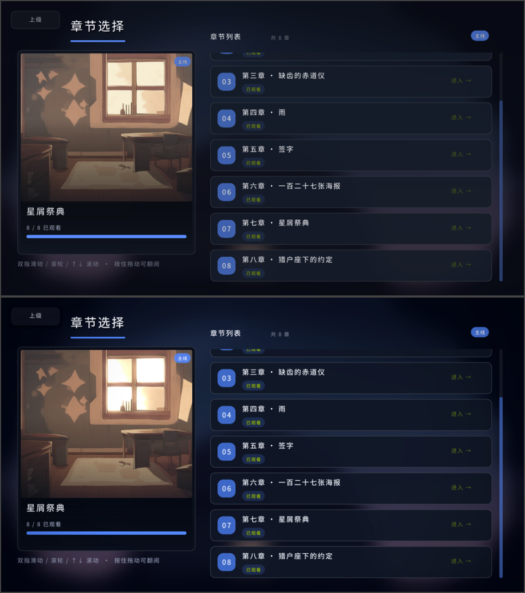
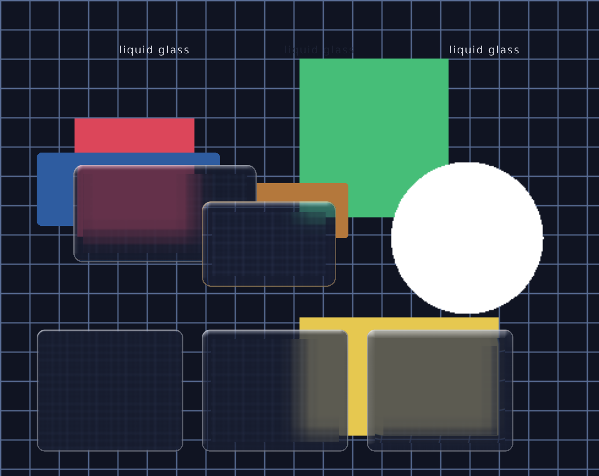

# QLWT 视觉小说引擎

基于 C++20 + **GLFW + OpenGL 3.3 Core**（自建 `gfx/` 渲染层，不依赖 raylib）的 galgame 引擎，使用一套自制的 `.gal` 脚本语言编写剧本。现代蔚蓝档案风格 UI：章节选择、圆角矩形控件、平滑缓动动画、全屏 CG（图片 / GIF / 视频）、存档读档、BGM / 音效。

## 快速开始

### 环境要求

- Windows，已安装 [MinGW-w64](https://www.mingw-w64.org/)（本项目使用 `C:\msys64\mingw64` 的 g++）
- GLFW3（`pacman -S mingw-w64-x86_64-glfw`；Linux / macOS 见下），OpenGL 由系统提供
- ffmpeg（可选，仅 MP4 等视频 CG 需要；引擎按 `QLWT_FFMPEG` 环境变量 > PATH > 常见安装位置 > 剪映自带 的顺序自动查找）

图片（PNG / JPG / GIF）、字体（TTF / OTF）与音频（WAV / OGG / MP3 / FLAC）分别由仓库自带的
`third_party/stb_*` 与 `third_party/miniaudio.h` 实现，**不需要再装 libpng / libvorbis / OpenAL**。

Linux / macOS 上依赖同样是「g++(C++20) + GLFW3 + 系统 OpenGL」：

```bash
sudo apt install g++ libglfw3-dev libgl1-mesa-dev   # Debian / Ubuntu
sudo pacman -S gcc glfw mesa                        # Arch
brew install glfw                                   # macOS
```

Wayland 不需要任何额外处理：系统 GLFW 会自己选 Wayland（跑不起来就退回 X11 / XWayland），
帧缓冲跟随显示缩放，150% 缩放的屏幕上也是按 1920x1080 真实像素渲染的。

### 构建与运行

```bat
powershell -ExecutionPolicy Bypass -File build.ps1   :: 编译（无需 CMake）
run.bat                                             :: 启动游戏
```

也可以直接运行 `qlwt.exe`。编译前请先关闭正在运行的游戏，否则 exe 会被占用无法覆盖。

项目自带一套由脚本生成的占位素材（背景 / 角色 / 表情 / CG / 音频），需要重新生成时运行：

```bat
powershell -ExecutionPolicy Bypass -File tools/make_assets.ps1
```

### 打包成发行版

Linux / macOS：

```bash
sudo apt install g++ libglfw3-dev libgl1-mesa-dev   # 依赖：g++(C++20) + GLFW3 + OpenGL
make -j8                                  # 日常开发：增量编译出 ./qlwt
make check                                # 发版前先跑一遍无头自检
make release                              # 产出 dist/qlwt-linux-x86_64/ 与 .tar.gz
```

`make release` 和日常的 `./qlwt` 有几点不同：

- rpath 从仓库内路径改成 `$ORIGIN/lib`，并把系统 `libglfw.so.3` 一起打包，
  于是整个 `dist/qlwt-linux-x86_64/` 目录拷到任何 x86_64 Linux 机器都能直接跑，
  只要系统有 OpenGL / X11 / Wayland 这些常规库，**不需要装 glfw 开发包**
- 二进制 `strip` 过；连 `assets/`、`docs/`、`README.md` 一起打包
- 引擎按可执行文件所在目录找素材，所以把这个目录整个给玩家就行

Windows 有两种做法：

- 在 Windows 上直接 `powershell -ExecutionPolicy Bypass -File build.ps1`，
  产出的 `qlwt.exe` 要和 `assets\` 放同一个目录（`qlwt.exe` 与 GLFW 静态链接，
  不需要额外的 DLL）
- 在 Linux 上交叉编译（需要 mingw-w64 工具链 + cmake；GLFW 源码仓库自带）：

```bash
make release-windows        # 等价于 bash tools/build_windows.sh
```

  产出 `dist/qlwt-windows-x86_64.zip`，解压即可玩：exe 已静态链接
  GLFW / libstdc++ / libgcc，目标机器不需要额外 DLL，Win10 及以上直接跑。

剧本里如果有 MP4/MOV/WebM 的 CG，再把 `ffmpeg.exe` 一起放进去（或让玩家自行安装）。

### 无头自检 / 调试命令

```bat
qlwt.exe --script 脚本.gal            :: 指定脚本进入游戏
qlwt.exe --check-script 脚本.gal      :: 无窗口校验：脚本能执行到 game_end
qlwt.exe --check-chapters 脚本.gal    :: 无窗口校验：每个 chapter 都能跑完
qlwt.exe --check-save 脚本.gal        :: 无窗口校验：中途存档后恢复能跑完
qlwt.exe --tree                       :: 无窗口打印剧情树（主线 / 支线 / 解锁条件）
qlwt.exe --check-assets               :: 无窗口校验素材：存在性 + 图片/音频可解码
qlwt.exe --selftest [--frames N]      :: 自动跑完整流程并截图（默认 20000 帧）
qlwt.exe --help                       :: 查看全部参数
```

## 操作

| 按键 | 功能 |
| --- | --- |
| 空格 / 回车 / 鼠标左键 | 推进对话（打字中按下 = 直接显示全文） |
| Ctrl（按住） | 快进 |
| A | 自动播放开关 |
| L | 对话历史（↑/↓ 或滚轮翻页） |
| F5 / F9 | 存档 / 读档菜单（6 个槽位，点击或按 1-6 执行） |
| Esc | 剧情中打开暂停菜单（继续 / 存档 / 读档 / 返回标题） |
| 1-9 / 鼠标 | 选择分支选项 |
| Enter / Esc | 章节结束询问：继续下一章 / 返回章节选择 |

设置从右侧滑出抽屉面板（内容可滚轮 / ↑↓ 滚动）：文字速度、音乐音量、音效音量、
**外观**（主题色预设 + RGB 自定义、圆角半径、按钮样式：深色 / 浅色 / 描边）、
全屏模式，改动即时生效并自动保存到 `settings.cfg`。

### 角色图集

开始菜单第二项「角色图集」：**剧情里登场过的角色会自动收录**，没登场的显示成
待解锁的剪影；点开看大立绘、身份和一句简介。收录进度记在 `progress.dat` 里
（`char|角色名` 行，和章节进度同一个文件）。

- 「登场」= 该角色在某段剧情里被 `show_character` 显示过，或说了一句台词；
  所以在无头自检（`--check-*`）里跑剧情不会污染你的收集进度
- 想看现成的效果：`./qlwt --gallery` 直接进图集

## `.gal` 脚本语言

完整命令说明书见 [docs/gal-script-manual.md](docs/gal-script-manual.md)。

基本规则：

- 一行一条命令，命令与参数用空格分隔
- `#` 开头是注释；`#RRGGBB`（恰好 6 位十六进制）会被识别为颜色
- 字符串用双引号 `"..."`，内部 `\"` 转义；含空格的内容必须加引号
- 标签 `@名字`（或 `@名字:`）与 `jump` 配合跳转，标签不能重复
- 脚本使用 UTF-8 编码（兼容 BOM）
- **素材路径不要使用中文**（引擎在 Windows 下读不了中文路径）

一个最小示例：

```gal
title 追光的人

init_character 晨星 assets/char/hero_body.png #6FA8FF center
init_bg 天台 assets/bg/classroom.png

show_bg 天台
show_character 晨星
say 晨星 "又是一个平凡的放学铃。"

choice 晨星 "要一起去吗？" {
    "当然！", jump yes
    "下次吧……", jump no
}

@yes
say 晨星 "好，那说定了！"
jump end

@no
say 晨星 "……好吧。"

@end
game_end
```

### 章节

每个 `.gal` 脚本是一个**大章节**（名字取 `title`），脚本内的 `chapter` 块是**小章节**：

```gal
chapter 1 "第一章 · 教室" picture assets/bg/classroom.png {
    show_bg 天台
    say 晨星 "……"
    game_end
}
```

- 章节体结束时自动结束本次游玩，不会流入下一个章节
- 章节进度记录在 `progress.dat`（每行 `脚本路径|章节编号`）
- **完整看完**一章（走到结尾 / `game_end`）才会标记为已观看；中途退出不标记
- 章节选择界面：未观看章节不可进入，只有已观看与“下一章”（金色描边）可进入；
  小章节列表支持滚轮 / ↑↓ / PageUp·PageDown / 拖拽滚动，条目超出屏幕时有滚动条
- 章节结束后弹出询问：继续下一章 / 返回章节选择

### 观测战（回合制战斗）

剧本里可以直接插战斗节点，打完按胜负跳到不同标签（**输了不 Game Over**，剧情照常往下走）：

```gal
# 头部：定义敌人与出战名单（队伍用已注册的角色名，数值查引擎内置表）
init_battle 云层的阻挠 "积云" 160 12 8      # id / 敌人名 / HP / 攻击 / 速度
init_battle 云层的阻挠 "夜雨" 135 13 11
init_battle_party 云层的阻挠 吴鸿韬 黎璘 梁知奕

# 剧情里：战斗节点
battle 云层的阻挠 {
    win  jump c7_sky_win
    lose jump c7_sky_lose
}
```

玩法：3 人小队 vs 1~3 个敌人，按 SPD 排出手顺序，轮到谁就给谁选 **攻击 / 技能 / 守住**；
每人有 SP（每回合回 1 点，技能消耗 3 点，不够时会提示且不消耗这一手）。
技能按角色区分：单体高伤（梁知奕·推演）、群体（尹博涛·冲刺）、治疗（黎璘·云志）、
全队增益（吴鸿韬·精确观测）、让敌人停手一回合（邵清和·熄灯、张誉腾·签字）。
超过回合上限（观测窗口 14 回合）算未完成。

**选目标**：普通攻击和单体技能打的是"当前选中"的敌人——点敌人卡片选中，或用 ←/→ 切换，
选中的那位会亮起脉动边框，倒下了会自动挪到下一个还活着的。群体 / 治疗 / 增益 / 眩晕不看目标。

**蓄力预告**：每 4 回合会有一个敌人开始蓄力（头顶挂红色「蓄力中」标记），
并锁定我方血最少的那位（我方卡片上出现红色「被锁定」标记）。它下一次出手会打出
约 1.8 倍攻击的单体重击。这一轮里你有四种应对：**守住**被锁定的那位（伤害减半）、
治疗抬血、用眩晕把它**打断**，或者干脆抢先把它打死。守住只保护当回合，回合结束就失效。

进出场用黑场过渡（剧情 → 淡入战斗 → 打完在结算画面停一下 → 淡出回剧情），
结算画面默认停 0.9 秒，也可以点一下提前继续。

敌人形象按优先级取：**剧本里显式指定的贴图** → **按名字分类自动找贴图** →
**代码画的图形**（发光球 / 云团 / 雪花噪点 / 六边形）。

```gal
init_battle 云层的阻挠 "积云" 160 12 8 assets/enemy/jiyun.png   # 第 6 项可选：这张贴图
```

不写第 6 项时，会按名字归类去找 `assets/enemy/<light|cloud|noise|solid>.png`：
带「光/灯/霓虹」→ `light`，带「云/雨/雾」→ `cloud`，带「杂讯/噪音」→ `noise`，
其余 → `solid`。都没有才用代码画的兜底图形。约定见
[assets/enemy/README.md](assets/enemy/README.md)（透明底 PNG、ASCII 文件名）。
仓库里这四张是本地 ComfyUI 生成的（`tools/imagegen/make_enemies.py`），
不透明的图会当"敌方立绘卡"画，自带透明通道的 PNG 则当浮动精灵。

调试：`./qlwt --script 脚本.gal --direct --selftest` 直接进第一段剧情（跳过章节选择），
`./qlwt --check-battle` 无头把每个剧本里的战斗都跑一遍（验证能打完、不卡死）。
`QLWT_BATTLE_DEBUG=1 ./qlwt --check-battle` 会额外打印每场结束时的双方血量，方便调数值。

### 剧情树（主线 / 支线）

`.gal` 头部可以写剧情树元信息，章节选择会按它画成一棵**可自由缩放 / 拖动平移的树**：

- **主线横着一条**：四卷从左到右串在这一条线上（蓝线）
- **支线竖着一条条**：每一卷的支线挂在那一卷的上面或下面，一条竖线（金线）串下来，
  卡片依次排在这条线上（每卷的支线在上下对半分，整棵树更矮更对称）
- 没满足前置条件的卡片会锁住（压暗 + "未开启"），**解锁条件写在"进入这张卡的那条线"上**：
  主线卷写在它和上一卷之间那段横线的上方，支线写在从它那一卷垂下来的竖线旁边；
  一条条件一行，底下垫半透明底板保证压在封面上也读得清

操作（触控板 / 鼠标都照顾到了）：

| 操作 | 触控板 | 鼠标 |
| --- | --- | --- |
| 平移地图 | **双指拖动** | 按住左键拖动（或右键/中键拖动） |
| 缩放 | **捏合**（两指开合） | 滚轮一格一格 |
| 兜底 | `Ctrl`/`⌘` + 双指滑动，或点左上角 `＋` `－` | 或点 `＋` `－` |
| 回全览 | `R` 或左上角「复位视图」 | 同左 |

> **触摸板手势是直接读内核的多点触控事件算出来的**（GLFW 只暴露滚动轴，拿不到 pinch）：
> 两根手指的中心点移动 = 平移，两点距离比 = 捏合倍率（见 `core/gesture.cpp`）。
> 双指拖动松手后会带一点惯性滑行（和系统触控板一致）；中途手指数量变了会重新取基准，
> 不会突然跳一下。捏合与拖动可以同时进行，锚点固定在鼠标位置。
> 拖动时两指间距的小抖动不会被当成捏合（要连续同向开合超过 3.5% 才进入捏合），
> 所以斜着拖是干净的直线；拖动本身直接跟手，不过缓动。
> 协议 A / B 两种多点触控上报方式都兼容；触摸屏（`INPUT_PROP_DIRECT`）会被跳过，
> 免得屏幕上的手指和触摸板上的手指混在一起。设置抽屉的双指滚动也走同一套手势。
> 需要能读 `/dev/input/event*`，否则自动降级成上面那行"兜底"：
>
> ```bash
> sudo usermod -aG input $USER      # 然后重新登录
> ./qlwt --check-gesture            # 不用真设备也能验证手势算法
> ./qlwt --gesture-monitor          # 真机上实时看设备枚举 + 每帧手势数值
> ```
>
> 捏合不灵 / 拖动不灵时先跑 `--gesture-monitor`：它会列出每个 `/dev/input/event*`
> 的判定结果（触摸板 / 触摸屏 / 不是多点触控 / 没权限），再实时打印手里有几根手指、
> 每帧的 pan 与 zoom。据此就能分清是设备没读到，还是手势没识别出来。

右下角显示当前缩放比例；点击是"松开时生效"，所以拖动不会误开卡片。

```gal
title "支线 · 云志"
series 星屑祭典                  # 所属系列
branch side                      # main = 主线，side = 支线
order 12                         # 同系列内排序
subtitle "黎璘 · 云志"            # 卡片副标题
requires star_festival_winter:8  # 解锁条件：那个脚本的第 8 章看完
```

无窗口查看整棵树的解锁状态：

```bash
./qlwt --tree
```

剧情总纲（世界观 / 时间线 / 角色课题 / 剧情树）见 [docs/story_bible.md](docs/story_bible.md)。

### 指令一览

| 指令 | 说明 |
| --- | --- |
| `title <文本>` | 大章节标题（显示在 END 画面与章节选择） |
| `init_character <名字> <贴图> <#RRGGBB> <位置>` | 注册角色（位置：left / center / right 或 0..1） |
| `init_character_face <名字> <目录>` | 设置表情贴图目录（`change_face` 从这里读取） |
| `init_bg <场景ID> <贴图>` | 预加载背景 |
| `show_bg <场景ID>` | 切换背景（淡入淡出） |
| `show_character <名字>` | 角色入场 |
| `hide_character <名字>` | 角色退场（先变黑再完全消失） |
| `move <名字> <位置>` | 角色平滑移动到新位置 |
| `change_face <名字> <文件名>` | 切换表情 |
| `say <名字> "<台词>"` | 对话框台词 |
| `narrate "<旁白>"` | 顶部旁白（无名字框） |
| `choice <名字> "<提问>" { "选项", jump <标签> ... }` | 分支选项 |
| `@<标签名>` / `jump <标签名>` | 标签与跳转 |
| `wait <秒数>` | 停顿（支持小数） |
| `card <文本>` | 章节 / 地点卡片 |
| `show_cg <文件>` | 全屏 CG：静态图 3 秒自动结束；GIF/APNG 动图、MP4/MOV/WebM 视频播完自动结束；点击可跳过 |
| `hide_cg` | 手动提前结束 CG |
| `play_bgm <文件>` / `stop_bgm` / `play_se <文件>` | 音频 |
| `game_end` | 结束游戏 |

## 素材目录约定

```
assets/
  scripts/   所有 .gal 脚本（文件名以 test 开头或 _ 开头会被章节选择跳过）
  bg/        背景图
  char/      角色立绘与表情目录
  cg/        全屏 CG（图片 / GIF / MP4）
  audio/     BGM 与音效
```

以上素材全部由 `tools/make_assets.ps1` 生成（纯合成占位图与合成音频，不包含任何第三方素材），可以随意替换成自己的图片 / 音乐。

立绘采用“本体 + 表情分离”模型：`init_character` 注册本体贴图，`init_character_face` 指定表情目录（内含 `normal.png`、`happy.png` 等），`change_face` 随时切换。没有表情素材时可以只用本体贴图，不调用表情指令即可。

## 特性

- 打字机对话、点击全文、名字牌、自动换行、对话历史、自动播放、Ctrl 快进
- 选项面板（鼠标 / 数字键）、分支淡入淡出
- 立绘淡入淡出、呼吸动画、说话角色轻微前移；角色退场走黑屏过渡
- 对话框背景随说话角色颜色平滑过渡（千恋万花风格）
- 顶部旁白、章节 / 地点卡片、章节结束询问
- 全屏 CG：静态图（3 秒自动结束）、GIF/APNG 内置解码、MP4/MOV/WebM 通过 ffmpeg 管道解码；黑屏无缝衔接过渡；重复播放 / 读档后视频从头开始
- 剧情中 Esc 暂停菜单（继续 / 存档 / 读档 / 返回标题）
- 存档 / 读档：6 个槽位（`saves/slot1.dat` ~ `slot6.dat`），带预览文本与时间
- SE 音效（BGM 也用同一套接口，支持 WAV / OGG / MP3）；本作目前只用 **9 个音效**
  （快门 / 翻页 / 风 / 钟表滴答 / 钟声 / 开门 / 闷雷 / 流星 / 点击），
  全部由 `tools/audio/make_audio.py` 程序合成，不含第三方素材；
  BGM 生成器仍在，剧本里的 `play_bgm` 已注释，想要音乐随时能开
- 章节进度系统与蓝档案风格章节选择（封面卡片、小章节缩略图、金色“下一章”）
- 全部按钮 / 对话框 / 面板为 12px 圆角矩形，圆角同心统一
- 抗锯齿分两层：整屏走"离屏渲染目标 + 双线性下采样"；
  所有会被缩放的贴图（**角色立绘 / 表情 / 章节封面 / 标题背景**）统一用
  `mipmap + 三线性采样`——`gfx` 的 `LoadTexture` 默认是最近邻（和 raylib 一致），
  而立绘是 480×900 画到约 634 高（每边缩到 0.7 倍），不设过滤就会掉像素、边缘出现硬阶梯
- 所有动画使用 smoothstep / easeOut 缓动，非线性不生硬
- 中文字体自动收集字形（脚本 + 界面文案），按需生成字体图集
- 设置持久化（`settings.cfg`）与全屏切换
- VSCode 语法高亮扩展（`.vscode/gal-lang/`，或安装 `qlwt-gal-lang-0.1.0.vsix`）
- 无头自检：脚本（`--check-script` / `--check-chapters` / `--check-save`）、
  素材（`--check-assets`）、剧情树（`--tree`）、窗口自检（`--selftest`）

## 渲染后端（GLFW + OpenGL 3.3 Core）

引擎早期用 raylib 做窗口与绘制，现在整块换成了仓库自带的 `gfx/`：**不再链接 libraylib**，
窗口 / 输入 / 音频 / 字体 / 图片全部自己接管，绘制是直接用 OpenGL 3.3 Core 写的 2D 批渲染器。

```
gfx/types.h    Color / Rectangle / Texture2D / Font … 类型与常量（沿用 raylib 的命名与语义）
gfx/gl_api.*   OpenGL 3.3 函数指针加载（GL 1.1 之外的入口，跨 Linux / Windows）
gfx/window.cpp GLFW 窗口、GL 上下文、输入状态机、帧计时、全屏、HiDPI
gfx/batch.cpp  2D 批渲染器：形状 / 贴图 / 离屏渲染目标 / 裁剪 / 着色器 / 变换栈
gfx/image.cpp  stb_image 解码、缩放、高斯模糊、纹理上传、mipmap、截图导出
gfx/text.cpp   stb_truetype 字形光栅化 + 图集打包、MeasureTextEx / DrawTextEx
gfx/audio.cpp  miniaudio：Sound（整段解码）/ Music（流式、默认循环）
```

设计要点：

- **保留同名 API**：`DrawRectangleRounded` / `DrawTextEx` / `Color` / `Rectangle` 这些名字没变，
  所以 `core/`、`game/`、`renderer/` 里上千处绘制调用基本没动，改动集中在后端，
  画面回归风险最小。算法（圆角矩形的分段、字形度量、文字换行、`DrawTexturePro` 的翻转规则）
  都是照着 raylib 5.5 的实现对齐的，因此替换前后的像素几乎一致。
- **批渲染**：顶点只有 位置(3) + 纹理坐标(2) + 顶点色(4)，攒够一批遇到"换贴图 / 换着色器 /
  换渲染目标 / 改裁剪 / 改变换"才真正 `glDrawArrays` 一次；变换通过 `mvp` uniform 下发，
  所以自定义着色器（毛玻璃那个）拿到的 `vertexPosition` 语义和以前一样。
- **坐标约定**：默认帧缓冲按**逻辑窗口尺寸**绘制（HiDPI 下投影负责放大到真实帧缓冲），
  离屏渲染目标按目标像素绘制，左上角为 (0,0)、y 向下——和 raylib 相同，
  所以 `renderer/` 里那些"裁剪框要自己乘 renderScale"的注释依然成立。
- **字体**：字形按实际用到的码点光栅化，图集用 `GRAY_ALPHA`（R=255、A=覆盖率）上传，
  padding 区域天然透明；灰度图靠 `GL_TEXTURE_SWIZZLE_RGBA` 把 R 铺到 RGB 上。
- **音频**：`Sound` / `Music` 只是句柄（内部挂着 miniaudio 的节点），拷贝共享、Unload 一次；
  没有声卡时自动退回 miniaudio 的"空设备"，解码与校验照常，只是不出声。

`third_party/` 里是几份单头文件依赖（stb_image / stb_image_write / stb_image_resize2 /
stb_truetype / miniaudio）与交叉编译 Windows 版用的 GLFW 源码，许可见 `third_party/README.md`。

## 画面特效

有了自己的 OpenGL 管线之后，引擎加了一层**屏幕后处理**和一套**统一转场**。
设置抽屉里有「画面特效」三档（关闭 / 标准 / 增强），默认**增强**；关掉时整个后处理不介入，
画面与替换 raylib 之前**逐像素一致**（见下）。软件渲染（llvmpipe）实测 1920x1080 下
每帧只多 0.6~1.2ms（实测 1920x1080：关 29.4ms -> 增强 30.0ms）：泛光只算 1/4 分辨率的缓冲，全屏只多一次采样。

### 后处理（`gfx/post.*`）

```
场景画进离屏 RT
      ├─ 亮部提取（阈值 0.80 + 软膝）→ 1/4 分辨率缓冲
      │        ├─ 横向高斯模糊
      │        ├─ 纵向高斯模糊
      │        └─ 增强档再来一轮（光晕更宽）
      ├─ 泛光按加色叠回场景 RT（BLEND_ADDITIVE）
      └─ 合成上屏：转场遮罩 → 调色 → 暗角 → 胶片颗粒
```

- **泛光**：只有窗口高光、星空、白字这类"真的很亮"的地方才发光（阈值 + 软膝，
  所以亮色面板 / 名字牌不会爆白）。标准档 1 轮模糊、增强档 2 轮。
- **暗角 / 胶片颗粒 / 轻微提饱和提对比**：都在最后一个全屏 pass 里，几乎不花钱；
  颗粒用每帧变化的随机种子，不会"糊"在画面上。
- **白闪**：`Engine::flash(strength, seconds)`，平方衰减。CG 从黑场亮出来、进入观测战时各提一下，
  像一次曝光。

### 转场（引擎统一负责）

场景切换不再各画各的黑场遮罩：`Engine::switchScene` 会播一段 0.36 秒的转场，
前半段旧画面退场、正中间换场景、后半段新画面入场，效果都在合成着色器里：

| 方式 | 效果 | 用在哪 |
| --- | --- | --- |
| `TransitionFade` | 黑场淡入淡出 | 返回标题、打开图集、默认 |
| `TransitionDissolve` | 噪点溶解 | 游戏里按 Esc / 章节结束回章节选择（"散场"） |
| `TransitionWipe` | 以某个点为中心的径向擦除 | 标题「开始游戏」从按钮中心展开、点开章节卡片从卡片中心展开 |
| `TransitionFlash` | 白闪 | 配合 `Engine::flash()` 用 |

用法是在 `switchScene()` 之前调 `engine()->setTransition(postfx::TransitionWipe, cx, cy)`
（`cx/cy` 是画布 uv，左上原点）；不调就用默认黑场。
场景自己那套 `entryFade` 已经删掉，避免和引擎转场叠加成"两次淡入"。

### 全局抗锯齿

设置抽屉里「抗锯齿」一档（关闭 / FXAA / MSAA 4x），默认 **MSAA 4x**：整幅画面的几何
（圆角面板、圆形徽章、进度条、立绘边缘、文字轮廓）都是有覆盖采样的，不再是硬阶梯。

- **MSAA 4x**：离屏渲染目标本身是多采样的（多采样 FBO + renderbuffer），
  `EndTextureMode()` 时 `glBlitFramebuffer` 把 4 个采样平均成 1 个像素。
  因为是在*几何光栅化*阶段采样，贴图内容（字形图集、立绘）不会被二次重采样，
  **文字依然锐利**——这是它比后处理抗锯齿强的地方。
- **FXAA**：在合成着色器里做（`gfx/post.cpp` 的 `fxaa()`），一次全屏 pass，
  最便宜，而且连后处理/转场出来的边缘也一起抹平；代价是文字会被轻微磨软一点。
- 关掉时整个后处理不介入，画面与替换 raylib 之前**逐像素一致**。

软件渲染（llvmpipe，1920x1080）实测单帧：

| 配置 | 单帧 | 说明 |
| --- | --- | --- |
| 抗锯齿关 + 特效关 | 29.2ms | 基准（= 替换 raylib 之前的画法） |
| FXAA + 特效关 | 31.2ms | +2.0ms |
| MSAA 4x + 特效关 | 33.5ms | +4.3ms |
| FXAA + 特效增强 | 35.5ms | |
| **MSAA 4x + 特效增强（默认）** | **35.2ms** | 约 28fps；真显卡上这点开销可以忽略 |

驱动不支持多重采样（或创建失败）时会打印一条提示并自动退回普通目标，功能不受影响。

### UI 质感

按钮和面板不再是"一块平涂的圆角矩形"，而是走同一个底板着色器
（`renderer/renderer.cpp` 的 `kButtonFrag`，圆角用距离场算，边缘自带抗锯齿）：

- **竖直渐变**：上端亮 10%、下端暗 9%（浅色底、描边底会自动收敛），平涂的塑料感没了
- **顶部内高光 + 底部内阴影**：1~2px 的"玻璃边"，按钮看着有厚度
- **柔和投影**：按钮下方 3px、7px 模糊的阴影；面板不加阴影（免得画面发糊）
- **悬停外发光**：主题色的指数衰减光晕（以前是三层圆角矩形硬叠，现在是连续衰减）
- **悬停抬起 / 按下压入**：悬停放大 1.6px、投影变深、文字跟着上移；按下缩小 1px、底色压暗
- 三种按钮样式（深色 / 浅色 / 描边）共用这套底板，只是配色不同；
  面板（章节卡片、设置面板这类超过 90x34 的）只借用渐变+高光，不加阴影

实测这套不增加可测开销（面板走不走底板着色都是 36ms/帧，多出来的 draw call 在 llvmpipe 上也测不出来）。



### 液态玻璃（实时折射）

对话框、设置抽屉、以及所有按钮都是**液态玻璃**，而且折射的是**当前这一帧里已经画好的画面**——
不是预渲染的背景快照。所以玻璃里能看到它背后的一切：背景、立绘、其他面板、按钮，
甚至另一块玻璃（玻璃叠玻璃也对）。

```
场景开始画 ──> 画到第一块玻璃时：
                 ① 把"当前已经画好的画面"blit 一份出来（多采样目标先 1:1 解析）
                 ② 重模糊 + 降采样到 1/4 分辨率（雾面底，两次可分离高斯）
                 ③ 恢复渲染目标状态，继续在原来的目标上画玻璃（采样①②的结果）
```

关键点是**没有反馈回路**：玻璃采样的是"拷贝出来的那一份"，不是自己正在写的目标。
一次性拷贝也让代价与玻璃数量无关（一帧抓一次，所有玻璃共用）。

玻璃本身的几层：

| 层 | 做法 |
| --- | --- |
| **圆角斜面折射** | 真玻璃的圆角是一圈斜面：贴边法线偏得最厉害、往里渐平。用 `sqrt(1-(1-t)²)`（圆剖面）沿法线取样，背后画面在边缘被"掰弯"、靠边内容被压缩 —— "有厚度"的关键 |
| ↳ **斜面用"锐利"源** | 雾面底是重模糊过的，在上面对内容做位移**根本看不出来**（背后本来就糊成一片）—— 所以贴边那一圈单独采未模糊的原始画面（1 号纹理单元），位移才可见。带宽十几像素，开销可忽略 |
| **色散** | R/B 的折射量差 16%，边缘一圈极淡的彩边 |
| **反光** | `(1-N·L)²` 的 Fresnel 边缘高光 + 顶部薄光 + **环境反射**（把雾面源上下翻过来采一次，真的会映出周围环境） |
| **边框** | 贴边一圈实色描边由玻璃着色器画（距离场，边缘干净）；游戏传进来的颜色比原来的 `palette().line` 亮得多 —— 深色面板上 alpha 40 的白等于没有 |
| **透镜放大** | 整个面板内的背景放大 2%：跨过轮廓的线条会明显错位，平滑背景上也看得出"这是块玻璃"（只靠斜面的话，背景越平滑越看不出来） |
| **按钮同样是玻璃** | 按钮的玻璃底复用面板那条路径（自己再写一套的边界情况太多），按钮着色器只叠高光/阴影/发光；描边样式额外补染色量 |
| **自适应底色** | 取该点背后的亮度，把叠加色的**明暗**往那边挪（色相不动） |
| **玻璃厚度** | 贴边内侧压一点点暗，模拟玻璃体吸收 |
| 圆角 | 距离场算的，边缘自带抗锯齿 |

参数：`renderer::drawBlurPanel(rect, tint, radius, bevelPx)`（斜面宽度；对话框 16、抽屉 18）。
`verification/probe_glass.cpp` 是验证探针：格子上先画两块不透明卡片，再盖玻璃、再叠一块玻璃，
卡片边缘在玻璃里被掰弯 —— 这就是"折射当前画面"和"折射背景快照"的区别。



**按钮也是真玻璃**：`drawButtonSurface` 用同一份折射源，本体按"折射底 + 按钮染色"合成
（透明度作用在染色上，不能在半透明底上再混一次背景，那样背景会被算两次、按钮淡到看不见 —— 踩过）。

**实现上踩过的坑**（都写在这了，免得下次再中）：

- 玻璃是在 `rt_` 的渲染过程**内部**画的，抓取时又要开离屏 pass（预模糊），而
  `BeginTextureMode/EndTextureMode` 会把当前目标/投影/视口/裁剪全改掉 ——
  不存快照的话整个场景会画到屏幕上去（症状：**整屏黑**）。
  现在抓取前后走 `gfxdetail::saveTargetState/restoreTargetState`。
- 多采样目标（MSAA 4x）不能用缩放 blit 读出来，必须 1:1 + `GL_NEAREST` 先解析，
  再缩放到抓取尺寸。
- 着色器编译失败的表现是"这块 UI 不见了"，不是花屏（见下面的排查小节）。
- **折射的剖面方向不能写反**：`sqrt(1-(1-t)²)` 在贴边处是 0、往里才最大，
  等于只把平滑背景"平滑地推了一下"——实测折射开/关的全图最大差异只有 **6/255**，
  肉眼完全看不出来。改成贴边最强、快速内衰减（外加 2% 透镜放大）之后，
  同一组 A/B 的最大差异是 **185/255、抽屉区域 91% 的像素在变**。
- **折射一定要做在"没被重模糊"的源上**：位移做在 1/4 分辨率的雾面底上同样看不出来，
  所以斜面那一圈单独采未模糊的原始画面。
- 面板/按钮边框别指望 `palette().line`（白 alpha 40）：深色底上等于不存在。
  面板边框现在交给玻璃着色器画、颜色由调用方给；按钮给了一条强度下限（`uEdgeFloor`）。
- **抓取尺寸必须按"设计分辨率"算，不能按渲染目标像素宽**：HiDPI 下 RT 是设计的 1.5 倍
  （1920 vs 1280），混用会让 `gBackdropScale` 差 1.5 倍 —— 玻璃采到的是**偏移且被放大**的画面。
  面板在平滑背景上根本看不出来（我第一版就这么"验过"了），小按钮上立刻暴露。
  现在比例一律按「贴图实际宽度 / 设计宽度」现算，设计尺寸由 `renderer::setDesignSize()` 告知。
- **不要为按钮再写第二套玻璃采样**：源矩形该传哪块区域、`fragTexCoord` 相对谁归一化、
  RT 的上下翻转怎么纠正 —— 每条都踩了一次（表现为按钮消失 / 倒影 / 把整张画面压进按钮）。
  现在按钮的玻璃底**直接复用面板那条路径**（`drawBlurPanel`），按钮着色器只负责高光/阴影/发光。
- **描边样式的按钮底色只有白 alpha 20**：一旦底色被换成"折射到的背景"就会整个消失
  （整屏只剩文字），所以玻璃底要额外给染色量，不能直接吃样式的透明度。
- 验证这类效果**不能只看单张截图**：要么做"特性开/关"的差分（见下），
  要么看游戏内原图放大，探针的高对比格子很容易把效果"看大了"。

**性能**（llvmpipe、1920x1080）：特效关 31ms、特效增强 + MSAA 4x **38~44ms**（软件渲染波动较大）。
比上一版"场景额外渲一遍背景快照"（41~43ms）**更快** —— 少的正是那遍多余的场景渲染。

已知简化：抓取一帧只做一次，所以同一帧里"后画的玻璃"折射到的是第一次抓取时的画面
（不包含之后才画的玻璃）。游戏里的绘制顺序下看不出来。

### UI 细节### UI 细节### UI 细节

- **按钮悬停柔光**：`renderer::drawButton` 里用三层低透明度圆角矩形向外扩散，
  跟随 hover 动画渐入（不用着色器）。
- **卡片高光扫过**：`renderer::drawShine(rect, radius, progress, strength)`，
  一条斜向光带 + 圆角遮罩，加色混合画在卡片上；「下一章」那条卡片会周期性地扫一遍，
  把玩家的注意力拉过去。
- **立绘脚下的柔和投影**：`Character::draw` 里叠几层低透明度椭圆，
  立绘不再是"浮"在背景上。

（特效相关的自检截图：`shot_transition` 是径向擦除进行中、`shot_story` / `shot_dialogue`
是剧情里的立绘 + 对话框。）

## 调试与验证

### 着色器排查

自定义着色器编译/链接失败时，`gfx` 会把驱动的日志原样打出来（`[gfx] 片段 着色器编译失败：...`），
并且对应的绘制会被跳过——**表现是"这块 UI 忽然不见了/变透明了"，而不是花屏**。
（踩过一次：GLSL 的 `const` 只能接常量表达式，写了 `const float x = clamp(...)` 之后
整块玻璃面板直接不画了，只剩边框，看着像"变透明"。）

另一个症状是**整屏黑**：渲染目标状态被冲掉（在 `BeginTextureMode` 里又嵌套开离屏 pass，
`EndTextureMode` 把状态恢复成了"默认帧缓冲"）。这类嵌套要么别做，要么用
`gfxdetail::saveTargetState/restoreTargetState` 包起来。

### 视觉回归怎么查

`verification/baseline/` 存着**替换前**（raylib 版）的 16 张自检截图，`verification/current/`
是刚换成 `gfx` 之后（UI 还是旧样式）用**同一初始存档状态**跑的同一套截图——
这两套是**移植保真度**的历史证据，当时做到了静止画面逐像素一致。

> 之后 UI 质感（按钮 / 面板）是**刻意重做**的，所以现在的截图和这两套不再逐像素一致。
> 改渲染代码后要做 A/B，请用同一份代码分别开关「特效 / 抗锯齿」来比
> （两样都关掉时后处理完全不介入），而不要再和 `baseline/` 比像素。
> 当前观感的留档在 `verification/ui/`，抗锯齿对比在 `verification/aa/`。

要复现当时的移植对比，用同一初始状态跑：

```bash
# 1) 先把初始状态恢复成基线那次运行时的样子（否则章节列表的"已观看/未开启"会不一样）
cp verification/state/progress.dat progress.dat
cp verification/state/settings.cfg settings.cfg
cp verification/state/slot1.dat   saves/slot1.dat

# 2) 跑自检并截图
QLWT_KEEP_SHOTS=1 ./qlwt --selftest --frames 300

# 3) 和基线比（RMSE 0 = 完全一致）
compare -metric RMSE verification/baseline/shot_chapter_select.png shot_chapter_select.png null:
```

实测结果：**已经静止的界面逐像素一致**（`shot_card`、`shot_chapter_select`、`shot_title`、
`shot_settings_drawer` 等的 RMSE 为 0）；只有"正在播动画"的那几帧（章节列表快速滑动
`shot_chapter_transition_b` / `shot_chapter_back_b`）会有 2~4/255 的平均差，而且
**同一个二进制前后两次跑也会差这么多**——自检里的动画是按真实帧间隔推进的，谁跑到这一帧
时动画相位都不完全一样。判断"是不是画错了"要看两点：
* 差异图里内容**不该整体位移**（把两张图做整数平移搜索，最优点应当在 (0,0)）；
* 静止界面的差应当是 0。

实测结果（特效开）：静止界面**逐像素一致**；只有动画中间帧差 0.2~1.8/255，
而且同一个二进制前后两次跑也会差这么多。

`verification/probe_input.cpp` / `probe_font*.cpp` / `probe_fx.cpp` 是几个小的自检探针（`probe_font.cpp` 是当时用 raylib 生成对照图集的那一份，需要 raylib 才能编，留作记录）：

```bash
# 输入状态机（刚按下 / 按住 / 松开 / 滚轮 / 鼠标坐标映射 / 退出键）
g++ -std=c++20 -O1 -I. verification/probe_input.cpp gfx/gl_api.cpp gfx/batch.cpp \
    gfx/image.cpp gfx/text.cpp gfx/audio.cpp -o /tmp/probe_input \
    $(pkg-config --cflags --libs glfw3 gl) -lpthread -ldl -lm && /tmp/probe_input

# 字形图集（和别的实现逐像素比对；QLWT_DUMP_FONT_ATLAS 指定导出路径）
QLWT_DUMP_FONT_ATLAS=/tmp/atlas.png ./verification/probe_font_gfx

# UI 特效：按钮悬停柔光 + 卡片高光扫过，导出 PNG 直接看形状
g++ -std=c++20 -O1 -I. verification/probe_fx.cpp renderer/renderer.cpp gfx/*.cpp \
    -o /tmp/probe_fx $(pkg-config --cflags --libs glfw3 gl) -lpthread -ldl -lm && /tmp/probe_fx /tmp/fx.png
```

验证玻璃/折射这类"特性开关"的效果，用**同一画面、特性开/关做差分**最可靠
（`verification/ui/refraction_ab_diff.png` 就是一次这样的差分，放大 4 倍显示）：

```bash
# 把渲染器里那一行强度临时置 0 编一版，拍同一帧，再换回来拍一次，然后差分
python3 - <<'EOF'
from PIL import Image            # 没有 PIL 就用 magick compare
import numpy as np
a = np.asarray(Image.open('with.png').convert('RGB'), int)
b = np.asarray(Image.open('without.png').convert('RGB'), int)
d = np.abs(a-b).max(axis=2)
print('最大差', d.max(), ' 差>4 占比', f'{(d>4).mean()*100:.1f}%')
EOF
```

**特效与抗锯齿都关掉时画面必须和替换前一致**，这是每次改渲染代码都该复查的回归项：

```bash
cp verification/state/settings.cfg settings.cfg
printf 'fxQuality=0\naaMode=0\n' >> settings.cfg
cp verification/state/progress.dat progress.dat
QLWT_KEEP_SHOTS=1 ./qlwt --selftest --frames 300
compare -metric RMSE verification/baseline/shot_chapter_select.png shot_chapter_select.png null:
# => 0（或 0.0003 这种级别的抖动）
```

> 探针注意：Wayland 下**第一帧的帧缓冲还没配置好**，截图会读到一块空白。
> 探针里先空跑几帧再画（`--selftest` 的自检截图在第 20 帧之后，天然避开了这个坑）。

> **关于 `--frames`**：`--selftest` 的路线图是"标题 -> 章节 -> 剧情 -> 战斗 -> 图集 -> 结束"，
> 剧情推进按**真实时间**走，所以帧数够不够取决于帧率。软件渲染（llvmpipe，约 40ms/帧）下
> 完整走完要 1200 帧以上；只跑前 300 帧能拿到 13~17 张截图，但最后会打印
> `SELFTEST FAILED (timeout)` —— 那是帧预算用完了，不是真的失败（不传 `--frames`
> 时默认 20000 帧，足够）。

## 项目结构

```
core/        引擎主循环、输入、时间、设置、字体、脚本解析器与解释器、视频播放、存档
game/        章节选择、标题 / 设置、游戏场景、角色、对话框、选项
renderer/    UI 绘制辅助（圆角面板 / 按钮 / 滑块 / 渐变）
gfx/         自建渲染 / 窗口 / 音频后端（GLFW + OpenGL 3.3 + stb + miniaudio）
third_party/ 单头文件依赖（stb_image、stb_truetype、miniaudio…）与 GLFW 源码
assets/      示例脚本与美术素材
docs/        脚本语言说明书
tools/       素材生成与测试工具（make_assets.ps1、gen_gif.cpp、build_windows.sh 等）
verification/ 视觉回归基线截图与小的自检探针
.vscode/     gal 语言扩展（gal-lang/）与 VSIX 安装包
```

## 常见问题

- **编译报 `Permission denied`**：游戏正在运行占用了 `qlwt.exe`，关闭游戏后重新编译。
- **MP4 CG 不播放**：缺少 ffmpeg。设置环境变量 `QLWT_FFMPEG` 指向 ffmpeg.exe，或安装到常见位置。
- **素材加载失败（`texture not found`）**：路径含中文。把文件 / 文件夹改成英文名。
- **脚本报错**：引擎解析时会给出具体行号与原因（未知命令、跳转目标不存在、重复标签、未闭合块等）。
- **想确认贴图抗锯齿是否生效**：设 `QLWT_NO_SMOOTH=1` 启动，贴图会退回引擎默认的
  最近邻采样（角色边缘立刻变回硬阶梯），用来做前后对照；不设就是正常的 mipmap + 三线性。
- **存档 / 进度在哪**：`saves/`（6 个槽位）、`progress.dat`（章节进度）、`settings.cfg`（设置），都在游戏目录下。
